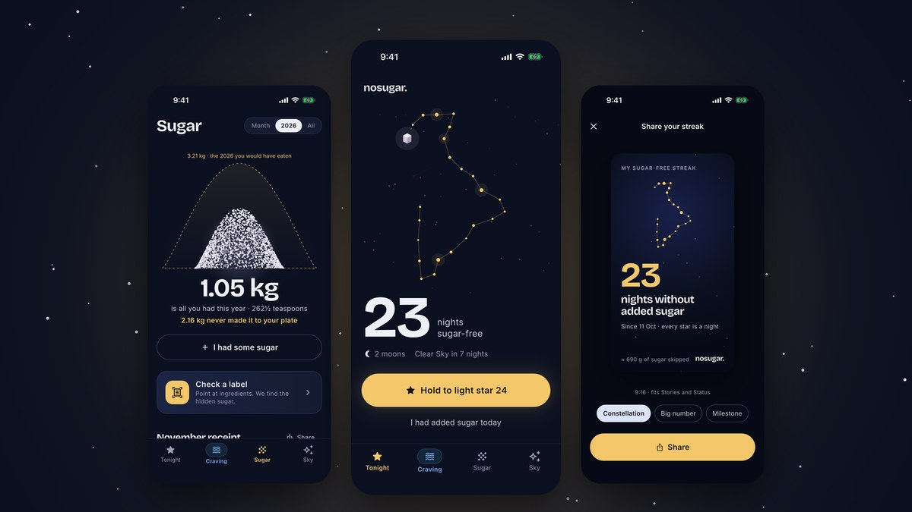
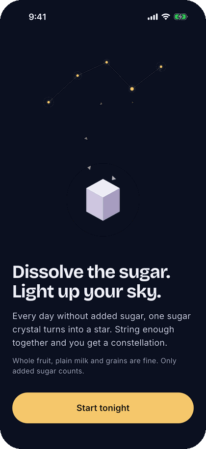
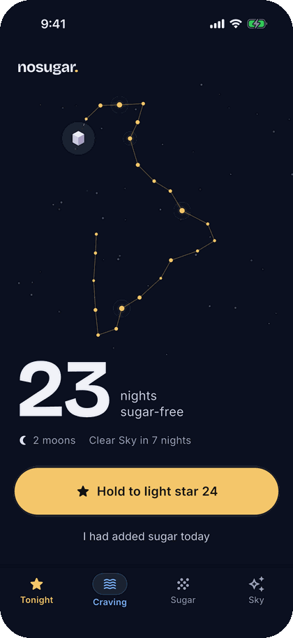
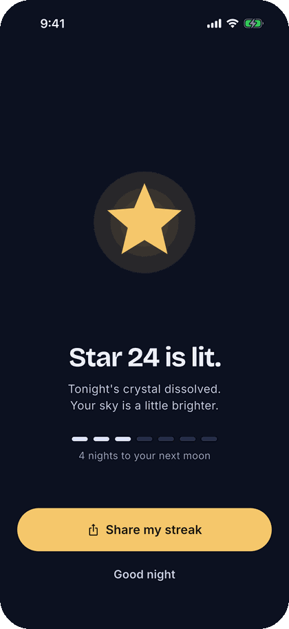
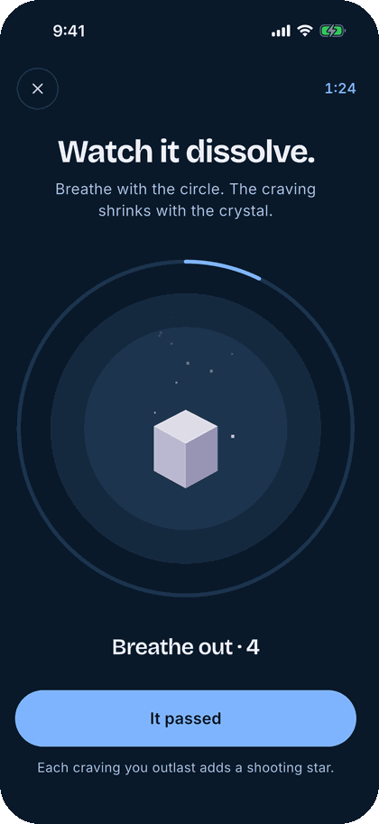
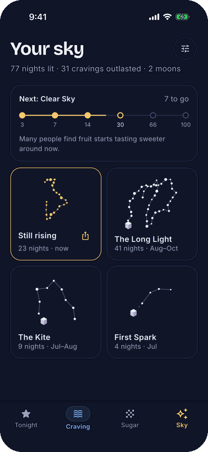
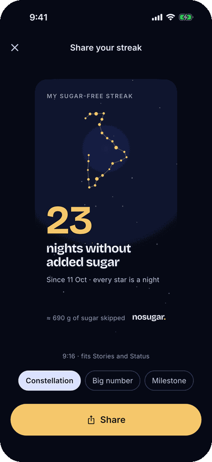
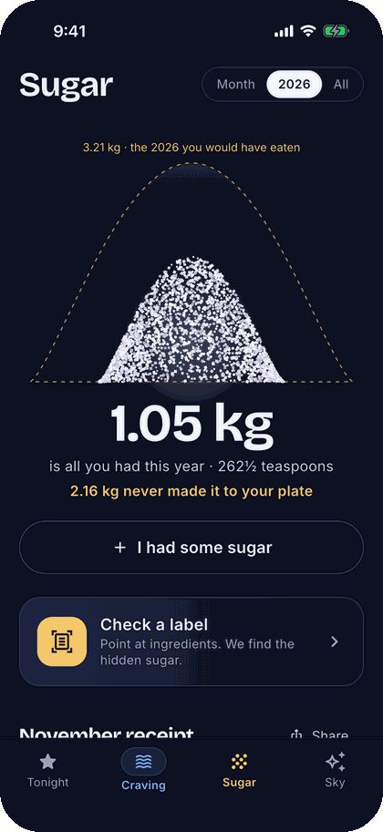
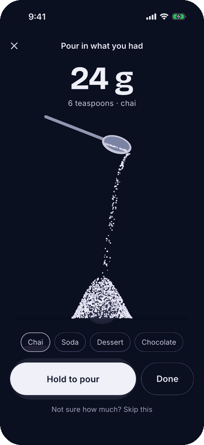
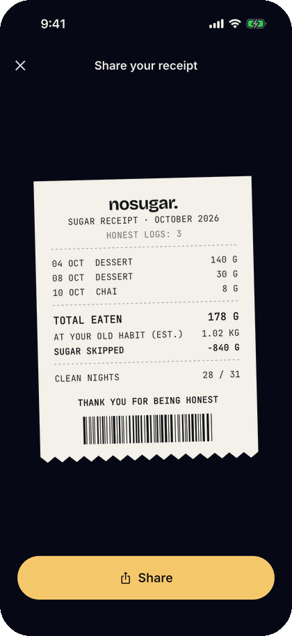

<p align="center">
  
</p>

<h1 align="center">nosugar</h1>

<p align="center">
  Every night without added sugar, a sugar crystal dissolves into a star.
</p>

<p align="center">
  
</p>

## The idea

Each day starts with a sugar crystal. Get through it without added sugar and, at night, you hold to dissolve it into a star. Nights in a row join into a constellation.

Slip, and nothing is erased. Spend a moon to forgive it, or keep the crystal and start a new constellation. Every sky you've made stays.

<br>

<table>
  <tr>
    <td align="center" width="33%"><br><b>Dissolve the sugar</b><br><sub>Fruit, plain milk and grains are fine.</sub></td>
    <td align="center" width="33%"><br><b>Hold to light a star</b><br><sub>One check-in a night.</sub></td>
    <td align="center" width="33%"><br><b>Star 24 is lit</b><br><sub>Every 7 nights earns a moon.</sub></td>
  </tr>
  <tr>
    <td align="center"><br><b>Craving SOS</b><br><sub>Breathe it out. Each one becomes a comet.</sub></td>
    <td align="center"><br><b>Your sky</b><br><sub>Milestones at 3, 7, 14, 30, 66, 100.</sub></td>
    <td align="center"><br><b>Share your streak</b><br><sub>Your constellation, made for Stories.</sub></td>
  </tr>
  <tr>
    <td align="center"><br><b>Sugar</b><br><sub>What you had, inside what you would have.</sub></td>
    <td align="center"><br><b>Hold to pour</b><br><sub>Log it a teaspoon at a time.</sub></td>
    <td align="center"><br><b>Your receipt</b><br><sub>A month of sugar, ready to share.</sub></td>
  </tr>
</table>

<br>

## Built with

Flutter for iOS and Android. Everything stays on the phone: no account, no server. The label scanner in the Sugar tab runs on-device with Apple Vision and Google ML Kit.

```sh
flutter test
flutter run
```

Add `--dart-define=DEMO=true` for a sky full of sample data.
